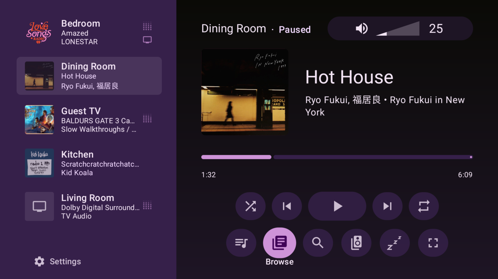
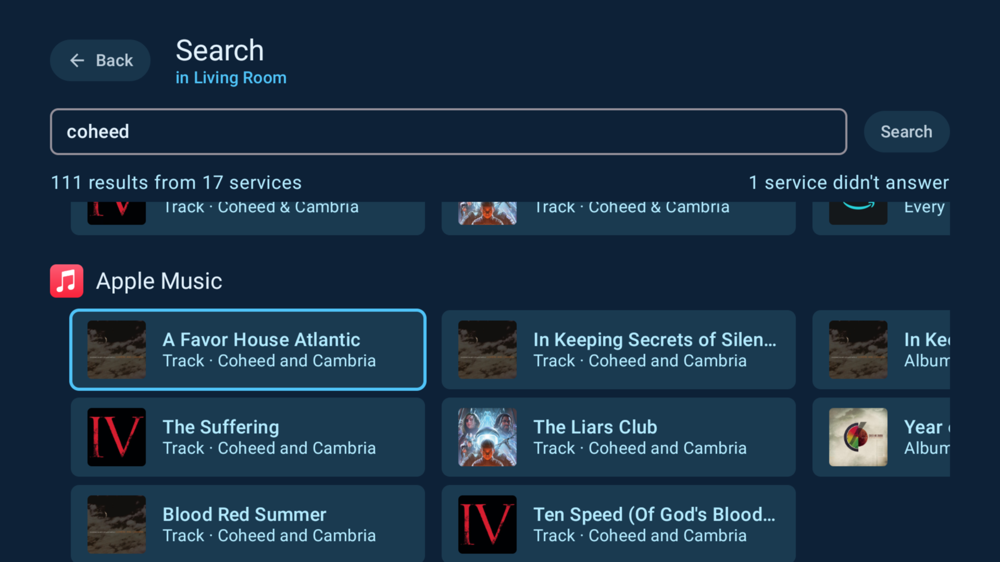
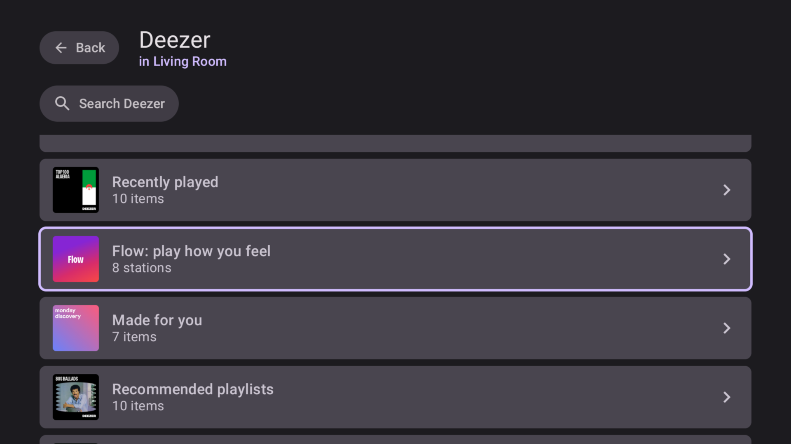

# x2rock

A Sonos controller for Google TV / Android TV.

It talks to the speakers directly over the local network, using the same Control API the Sonos
apps use, with **no Sonos account, no sign-in and no polling**: subscribe, and the speakers push
every change.

> **Test builds are out.** x2rock is not on Google Play yet; each test build is an APK on the
> [releases page](https://github.com/rahga/x2rocktv/releases), installed by hand as
> [this guide](docs/install-on-google-tv.md) shows. It needs a Google TV or Android TV device and a
> Sonos system on the same network. Speakers neither of our households has are especially welcome: a
> Port, Five, Amp or Play:5 with something on its line-in, or a Roam or Move. Reports go through
> **Settings → Beta features → Send a report**, or
> [an issue](https://github.com/rahga/x2rocktv/issues/new). Please don't post your email address there.

> We'll need to track 12 testers for 14 consecutive days before this can reach Google Play store,
> where it will be posted for free with no advertisements. To be one of them, join
> [x2rock@googlegroups.com](https://groups.google.com/g/x2rock); the link to opt in on Play will be
> here when the test opens. Members can't see each other's addresses.



*Every room down the left with what it is playing, a soundbar on its TV input among them; the
selected room's player on the right.*

<table>
  <tr>
    <td width="50%"></td>
    <td width="50%"></td>
  </tr>
  <tr>
    <td><em>One search across every music service the household has, plus Apple Music, each
    answering in its own section.</em></td>
    <td><em>A service opens on its own front page, here Deezer's, with its personal shelves.</em></td>
  </tr>
</table>

*Screenshots from an NVIDIA Shield, 12 October 2026.*

## What it does

- **Rooms**: play, pause, skip, seek, volume per room and per speaker, grouping, and "Play
  everywhere".
- **Music**: Sonos favourites, the queue, radio, browsing each music service from its own front
  page, and one search across all of them.
- **TV**: switching a room to its soundbar's TV input, with Night Sound and Speech Enhancement.
- **Room settings**: bass, treble and loudness, a Sub's and surrounds' levels, the status light,
  touch controls, crossfade, and a sleep timer.
- **The household**: alarms (made, changed and removed here), and which speakers have an update
  waiting.

In daily use on an NVIDIA Shield (Android 11, Ethernet) and a Google TV Streamer (Android 14,
Wi-Fi). Speakers are found by SSDP, with mDNS as the fallback on networks that drop SSDP. What is
still open is at the head of [`docs/punch-list.md`](docs/punch-list.md), and
[`docs/sonos-app-comparison.md`](docs/sonos-app-comparison.md) compares it with the Sonos app,
service by service.

A few features have never run against a real speaker, because neither household has the hardware:
Line-In, and a portable's battery. They stay hidden until **Settings → Beta features** is turned
on, and each says "Beta" where it appears. **Send a report**, under that same switch, shows a QR
code that opens a draft GitHub issue describing your system, so a tester can tell us what happened.

## Building

You need a JDK (17+; 21 is what has been tested) and an Android SDK, named by `sdk.dir` in
`local.properties` or by `ANDROID_HOME`. There are no credentials to supply. Gradle is fetched
by the wrapper.

Open in Android Studio and run `:app`, or:

```sh
./gradlew :app:installDebug
```

A debug build is several times slower on a TV box than a release one, so judge speed from
`./gradlew :app:assembleRelease`.

The released APK includes a local build input used to read music-service sign-ins from the
speakers and communicate with public SMAPI endpoints. Without it, x2rock controls the rooms
and plays favourites, but has fewer services to browse/search and says so on screen.
See [release notes for builders](docs/play-release.md).

## Tests

```sh
./gradlew :core:test :app:testDebugUnitTest            # against a fake player; what CI runs
./gradlew :core:test -Dx2rock.live=discover            # also against real speakers, read-only
```

## Layout

The Sonos layer, `:core`, is a plain Kotlin/JVM library with no Android dependency, so it can be
exercised against real speakers from a plain JVM test; `:app` is the TV frontend. See
[`docs/lan-transport.md`](docs/lan-transport.md) for the protocol and the evidence behind it,
`ARCHITECTURE.md` for the layout, and `CLAUDE.md` for the conventions.

## License

x2rock is free software under the [GNU General Public License, version 3](LICENSE) only
(`GPL-3.0-only`): use it, change it and share it, and anything you distribute that is built on
it is released under the same terms, with its source.

## Caveats
Features rely on LAN compatibility with Sonos firmware and content providers that allow direct
SMAPI access. Apple Music search uses Apple's public catalogue instead. Providers such as YouTube
Music do not allow this app's direct SMAPI browse/search; their catalogues are not offered here.

Maintainer contact here:
[github.com/rahga](https://github.com/rahga)
